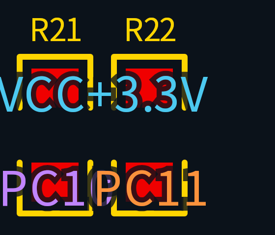
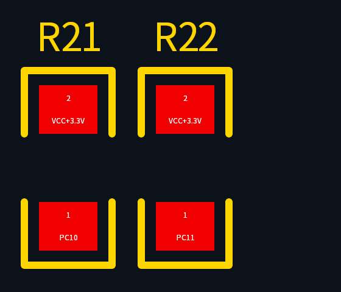

# Independent PCB renderer

The PCB preview uses an independent Rust scene compiler and React Native Skia.
Rust owns project download, history authentication and replay, footprint expansion,
geometry, draw batching, and picking. The UI draws the returned SVG paths and
handles the viewport and layer controls. No EasyEDA viewer renderer or closed
`smt-gl-engine` code is imported, linked, copied, or required at runtime.

## Data path

1. Read the public Pro project and its default branch to obtain the history head.
2. Follow parent history IDs until the root or a snapshot. Each history includes
   part zero and every suffix through `num` inclusive. Snapshots use `snapshotUrl`
   and `snapshot_num`, with the snapshot ID as their IV.
3. Authenticate each part with AES-GCM, then gunzip UTF-8 record logs, consuming
   all concatenated gzip members within one output budget and rejecting trailing
   unparsed bytes. Public
   projects tested here use a 128-bit key and 128-bit IV; the decoder also accepts
   256-bit keys and 96-bit IVs. It rejects invalid authentication and oversized
   output.
4. Replay from oldest to newest into documents keyed by UUID. A record key is
   `(document, type, normalized ID)`, including IDs serialized as JSON arrays.
   Higher logical tickets win; equal tickets prefer the lexically smaller client
   ID. Empty bodies remain tombstones. `DELETE_DOC` suppresses deleted documents.
   After the existing per-line whitespace trimming, opaque record headers remain
   as JSON strings during replay, including unknown fields; ticket/client/ID values are extracted for conflict
   resolution without retaining a separate header object tree for each record.
5. Resolve a component's `Footprint` attribute against the replayed project.
   `Device` references can resolve through live device metadata; deleted devices
   cannot restore referenced footprints. Expand footprint
   primitives, attach board `PAD_NET` values, compile paths, and create the picking
   index. No separate external footprint service is required for the checked
   public project.

## Schematic scenes

The same history replay can target a `SCH_PAGE` document. The schematic
compiler indexes `SYMBOL` documents and their `PART` records, applies the
component transform, and emits the existing `Scene`/`DrawBatch`/`TextLabel`
protocol. Logical layers separate wires, buses, symbols, pins, text, shapes,
and junctions. Visible attributes and symbol metadata remain available in
`PickResult.properties`; net attributes become `PickResult.net`.

Schematic scenes use their own bounded two-entry picking cache. The `pick`
command first checks the PCB cache and then the schematic cache, so scene IDs
remain opaque and the bridge does not need a second picking command. Missing
pages return `schematic_not_found`; expired scenes return `scene_expired`.
Unsupported records stay visible in the warning panel. The implementation
shares the history, path, transform, contour-hit, object and generated-path
limits with PCB scenes.

Requests use the core client's HTTPS host allowlist, response limits, timeouts,
and explicit status/MIME validation. The loader downloads four parts concurrently
while preserving replay order. Decompression, replay, and scene compilation run
on a blocking worker rather than the async network executor.

## Geometry and rendering contract

The scene contains `layers`, `batches`, fallback `texts`, `bounds`, `warnings`, and
load/parse/scene metrics. Batches carry a layer, SVG path, fill/stroke mode, stroke
width, and optional object color. Adjacent compatible paints are combined, with a
512 KiB batch threshold. Skia should use nonzero filling and round stroke joins
and caps. Changing the entire layer to even-odd filling would cancel overlapping
copper.

PCB coordinates stay in document units. Actual PCB examples behave as mil-based
coordinates; the canvas unit is a display preference, so the API does not label
arbitrary raw coordinates as millimeters. The compiler subtracts the canvas
origin and flips Y once. Clients consume scene coordinates directly.

Components apply translation, positive rotation, and a local Y mirror for the
bottom side. The mirror occurs before rotation. Bottom components swap paired
layers 1/2 through 9/10. Polygon pads already contain footprint coordinates;
their copper is not reanchored to the pad center. Hole offset and relative angle
apply to the drill separately.

The implemented primitives include lines, circular arcs, cubic/quadratic paths,
rectangles and circles, pads, vias and drills, polygons/fills, poured copper,
vector images, embedded font outlines, and approximate dimension lines/text.
Visible `ATTR` keys and values use the same embedded-outline or fallback text
path. Board attribute records keep their absolute placement and replace matching
footprint attributes, including hidden overrides. Inherited footprint labels use
the component transform and bottom layer mapping. Empty, malformed, or complex
visible values produce warnings rather than disappearing silently.
`POURED.pourFill` coordinates and widths are scaled by ten; its angles are not.
Stale poured records without a live `POUR` are skipped with a warning. Outlines
alone do not become filled copper.

Closed contours are classified by nesting, then normalized for nonzero filling.
Independent glyph islands remain outer contours and nested contours form holes.
Native circular arcs are retained under board/component transforms; circular
arcs under nonuniform image scaling use bounded polygon approximation. Picking
uses flattened geometry, with 0.05 document-unit arc flattening tolerance before
any nonuniform image scaling, and fixed cubic/quadratic subdivisions.

Layer 47 contains drill masks and is drawn last in `#0b121a`, matching the canvas
background. The UI must keep these colors synchronized. Copper, silkscreen,
outline, and drill layers are enabled by default when the source layer is shown;
mask, paste, and technical layers remain selectable in layer controls.

## Viewport and compact layouts

Fitting keeps world coordinates unchanged and caps each canvas margin at 15% of
its available width/height, up to the requested padding. A short canvas must not
shrink the board to a few pixels merely to preserve a fixed margin. The canvas
fills the workspace below its compact document header. Viewer entry hides the
application navigation on all sizes; returning restores the previous screen.

Tools, zoom controls, and panels float over the canvas. Opening a panel does not
resize the drawing surface, refit the board, or rebuild its pictures. Layers,
scene information, and picked properties share one panel slot. At widths below
600 logical pixels, portrait panels open above the bottom controls; other sizes
use a right-side panel. Windows below 500 logical pixels high use horizontal
tool groups, omit the canvas hint and orientation badge, and keep a bounded,
scrollable side panel. The
network appears first in picked properties so it remains visible at 240px height.
System font scaling remains enabled. All tools have at least 44px touch targets.

Picked properties use a content-sized card: the heading prefers a component
designator or pad number, followed by a readable object type and layer. Labeled
rows show network, value, footprint name, and other supplied attributes. Internal
record/component/device IDs and tickets are collapsed under technical details;
selecting a new object collapses them again. Long values wrap within a bounded
scroll area, keeping the close control reachable. Rust merges inline component
attributes with board overrides for picking and resolves footprint names from
the existing footprint META. This display metadata does not modify the separate
board-attribute table that controls inherited label replacement and visibility.

Layer order is memoized from the source defaults and does not jump when layers
are toggled. Panel closure preserves layer visibility and the viewport. Timing
metrics and nonfatal display warnings live in the information panel; its entry
shows a warning count without taking space from the canvas. Picking and drawing
errors remain directly visible. The dark canvas stays synchronized with the
drill-mask color above; this UI change adds no grid, rendering passes, or blur to
the drawing surface.

## Networks and pad labels

The reference is the PCB editing canvas in the installed 嘉立创EDA(专业版)
V4.1.60: small white pad numbers and network names sit inside individual pads.
This differs from its material-oriented “2D预览” window. See the professional
[network display settings](https://prodocs.easyeda.com/en/pcb/settings-pcb/)
and [network highlighting](https://prodocs.lceda.cn/cn/pcb/view-highlight/).

Batches retain network and primitive kind when merging. Separate `netLabels`
retain each pad's number, position, dimensions and rotation before batching loses
individual object boundaries. Footprint labels use the same component transform
and `PAD_NET` binding as copper. Schematic scenes emit an empty label list.

Normal labels are white, fit their pad or straight track segment, and use 8–12
logical-pixel fonts. Pad numbers and network names occupy separate rows. Labels
below readable size, outside the viewport, on hidden layers, or colliding with
other labels are omitted. Drilled pads and vias place text beside their copper;
drill areas remain reserved even when via labels are disabled. Copper network
highlighting preserves stroke width and excludes drill/mask drawings. Color
controls affect highlighted geometry rather than ordinary text.

Label pictures update with the viewport independently of the highlight picture
and raster cache, so zooming does not reparse highlighted SVG paths. The network
panel retains location, hover highlighting, category switches, preset colors,
and H / Shift+H controls. Its counts represent copper draw batches.

The following original two-resistor fixture is rendered with the actual CanvasKit
backend at the same 8× scale. The upper copper batch deliberately contains two
pads sharing `VCC+3.3V`. Tests check all four pad regions, screen font limits,
rotation, collision avoidance, drill clearance, layer visibility and switches.

Before:



After:



Custom polygon-pad interiors do not yet provide a safe text box, so their labels
remain available through picking rather than being overlaid. Curved tracks only
offer their longest flattened straight segment for labels. Native-device visual
validation remains separate from CanvasKit and browser checks.

## Interaction raster cache

Layer pictures retain the complete vector geometry. Replaying them on every
camera update is expensive on complex boards, so interaction draws an overview
image plus an optional viewport-detail image. One shared camera value updates
scale and translation atomically. The Canvas subtree is memoized independently
of panels, zoom labels, and picking results.

The overview covers the board with a 10% margin and a maximum 2048-pixel side.
After 180 ms without camera input, detail is rasterized from the original
pictures at viewport scale times device pixel ratio, with a 12.5% viewport margin.
An existing detail is reused while it covers the view at sufficient density;
returning to overview density releases the detail reference. Active touch
gestures cancel refinement until release. While moving, the overview remains
underneath the previous detail, so moving outside that detail never exposes an
uncached part of the board. Motion can temporarily look softer until refinement.

Each image is bounded to 4096 pixels per side and 4,194,304 pixels total. At four
bytes per pixel, the two retained images have a nominal pixel budget of at most
32 MiB. This excludes GPU copies, intermediate allocations, retained vector
pictures, and replacement images awaiting garbage collection. High-DPI views
can reach the pixel cap and have less than one image pixel per physical pixel.

`Surface.Make` uses a CPU raster surface on both backends; its snapshot can be
uploaded by a different CanvasKit WebGL context. The surface is disposed after
the snapshot is taken. Images use the same opaque background as drill masks, so
detail replaces overview pixels without blending duplicate geometry. Scene,
font changes rebuild the overview. Visible-layer changes keep the mounted Canvas
and its current image while the replacement is built offscreen. If the same
scene already has detail, its region and density are rebuilt too, then both
images are published together without resetting the camera or inserting a
loading screen. This retains the two-image budget rather than allocating a
high-resolution image for every layer. A failed optional detail build publishes
the new overview alone and reports a warning; overview failure displays an
error, cleared after a successful rebuild. New scenes never display old-scene
rasters.

`pcb.raster.built` logs layer count, pixel dimensions, and build time;
`pcb.raster.refine_failed` includes the scene ID and error. The information panel
also shows overview/detail sizes and build times. Picking still uses Rust vector
geometry and the inverse camera transform. Future editing must invalidate the
pictures and images for changed geometry before publishing an updated scene.

## Picture and image ownership

`buildPictures` explicitly releases temporary paths, paints, fonts, and recorders,
and disposes partially built pictures if compilation fails. Once pictures are
published to `Canvas`, its independent render root and recorded commands can
retain them beyond the owning React effect's cleanup. Cleanup must not manually
dispose those published handles: Fast Refresh preserves React state while
restarting effects, so a pending draw could otherwise receive a deleted picture.

Published pictures and snapshot images follow their reachable Skia handles.
CanvasKit's Embind `sk_sp<Picture>` and `sk_sp<Image>` wrappers register with
`FinalizationRegistry`; native JSI objects release their smart pointers during garbage collection,
scheduling GPU resource release on the creating thread. Browser lifecycle tests
exercise StrictMode, three consecutive Fast Refresh updates, unmounting, real
canvas pixels, and picture/image finalizers after forced test GC. Collection timing is
not deterministic in normal use, and releasing live resources does not guarantee
an immediate reduction in process RSS/PSS.

## Picking and retained state

`pcb::pick(scene_id, x, y, tolerance, layers)` first queries a 100-unit spatial
grid, then tests actual strokes/filled contours. The optional layer filter must
match the UI's current visible layers. Actual primitive geometry takes priority
over component bounding boxes across all layers. Component candidates use only
their actual drawn layers and return a currently visible layer. Drill masks do
not make an otherwise hidden component selectable. Drill holes are excluded from the pad/via copper hit
geometry. Large objects use a separate bounded candidate list.

The core retains at most two picking scenes, containing owned object IDs,
properties, flattened geometry, the spatial index, and layer metadata. The full
replayed project, including opaque headers, bodies, unknown types, and tombstones,
exists while compiling and is released when the read-only scene is returned.
Eviction yields `scene_expired` on later picks. The current product exposes no
edit/save operations. A future editing entry point must reload and own the full
project state; a picking scene is insufficient to reconstruct the source records.

Releasing the replayed project lowers live retained allocations, but the loader
still downloads all encrypted parts before replaying the complete project in
memory. Compact headers reduce this replay peak; they do not make the loader
streaming. An allocator may retain freed pages, so lower live allocations do not
guarantee an immediate matching reduction in process RSS/PSS. Native memory and
load-time peaks require separate device measurements.

Limits include 256 history versions, 1,024 downloaded parts, 16 MiB per encrypted
part, 128 MiB total download, 256 MiB decompressed history, one million records,
20,000 documents, 128-byte client IDs, 200,000 scene paints, and 64 MiB of generated SVG path data.
Individual geometry is also bounded. Missing parent pages, cycles, malformed
logs, and limit violations return explicit core errors.

## Validation and current limits

Unit fixtures are original miniature records, not copied board artwork. Tests
exercise AES-GCM authentication and gzip limits, chunk/snapshot enumeration,
record conflict rules and tombstones, history pagination, document deletion,
bottom transforms, arcs, rounded pads, pour scaling, nonzero contour topology,
image anchoring, footprint/net resolution, geometry picking, visible layers,
rotated text bounds, zero polygon mask expansion, and visible attribute labels.

The public development-board project
`90602f2f840d4245a97479e90a31d17b`, PCB `d4c95e111c8e5672`, was loaded through the
actual Rust network/decrypt/replay/compiler path on 2026-10-23. Its replay contains
23 histories, 65 encrypted parts, 266 documents, and 282,807 records. All 239
footprint references resolve within the project. These are coverage observations,
not a claim of complete support for every Pro document or mobile performance.
Use the current smoke output for timings and scene totals:

```sh
cargo run -p oshwhub-core --example smoke -- \
  '{"command":"pcb","projectId":"90602f2f840d4245a97479e90a31d17b","documentId":"d4c95e111c8e5672"}'
cargo test -p oshwhub-core pcb::
```

Known gaps emit scene warnings where relevant: special per-layer pad shapes use
the default pad; nonzero polygon pad mask/paste expansions are omitted; hatch
fills show outlines; blind/buried-via spans are approximated as multilayer rings;
reverse text expansion, exact dimension arrows/styles, and external raster
images are unsupported. Text without matching embedded outlines uses the system
font, so its shape and metrics are approximate. Self-intersecting polygon
topology and all producer-version variants have not been exhaustively validated.
Native gesture/device visual validation is separate from these core checks.

## Read-only 3D

The same retained scene also owns bounded board outlines, drills, surface paints,
stack-up thickness and model bindings. `pcb3d` compiles these in Rust on first use,
without retaining or downloading the full replay again. Closed outlines are
extruded after subtracting the union of drill shapes; top/bottom surface paints
are clipped against that solid. Invalid outlines or missing stack-up data produce
explicit fallback warnings. See [3d.md](3d.md) for format and model limitations.

The independent WebGL renderer uses Expo GL on native and a DOM canvas on desktop.
Packed meshes deduplicate identical position/normal/color tuples and carry u32
indices. Devices without the u32 index extension expand them once on upload.
Duplicate components reuse their vertex/index buffers and precomputed normal
matrices. Model loading has three workers and a 64 MiB GPU buffer budget; the Rust
model cache holds at most 16 assets / 48 MiB. Failed assets do not block the board.

Gestures only change a local camera ref and coalesce into one animation frame;
they do not rebuild meshes or call Rust. Idle/hidden canvases do not run a draw
loop. A 2D/3D switch keeps both mounted after first use to preserve the 2D camera
and layers, hides inactive accessibility content and keyboard focus, and releases
GPU buffers/programs when leaving the viewer. Web GL context loss shows a reload
action. These controls do not imply 3D picking, editing or export support.

## Sources and licensing

- [EasyEDA file-format documentation](https://github.com/easyeda/easyeda-file-format),
  revision `9186c4ac43e67d1bb111ada3f5cc020b76bc543a`: protocol fields and primitive
  semantics. The earlier `easyeda-pro-file-format` URL redirects here. GitHub did
  not report an SPDX license for the documentation at validation time.
- [easyeda-viewer](https://github.com/easyeda/easyeda-viewer), revision
  `1c841a7fdcdc382f7a516a4f5a261ad34cb8162d`, is Apache-2.0. It was
  consulted as a format cross-check; its renderer implementation was not reused.
- Public project responses and encrypted history parts established actual record
  variants. The installed EasyEDA Pro project worker was inspected statically for
  chunk/snapshot protocol behavior; no proprietary implementation was copied.
- The checked source board is published under CC BY-NC-SA 4.0. Downloaded board
  data and generated previews stay outside the repository; they are not test
  fixtures or application assets.
